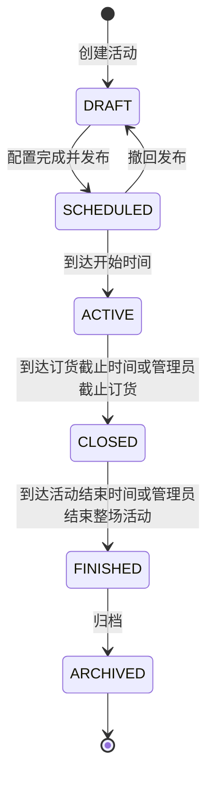
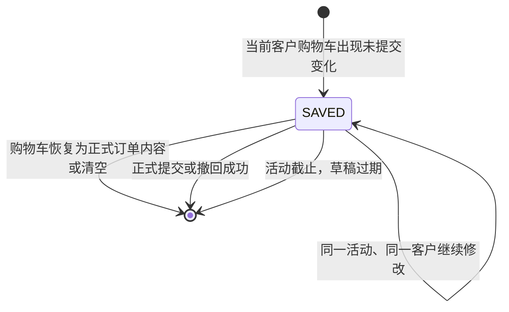
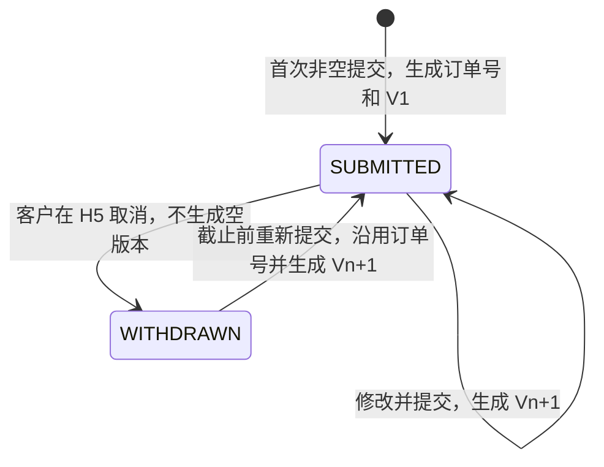
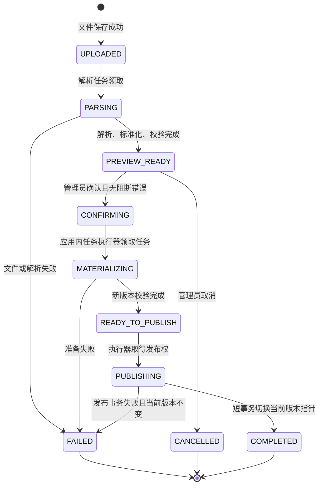
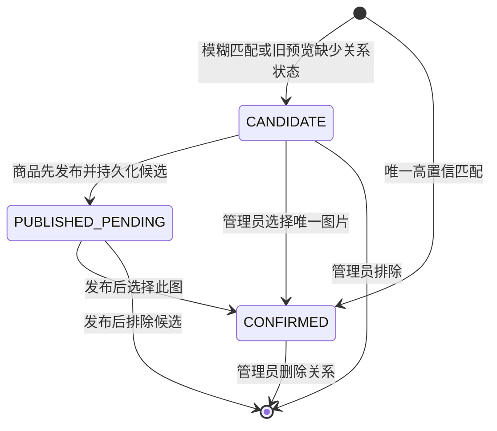
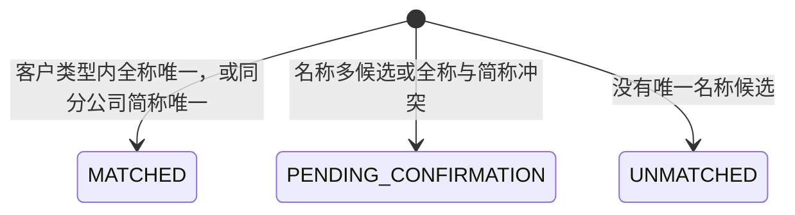
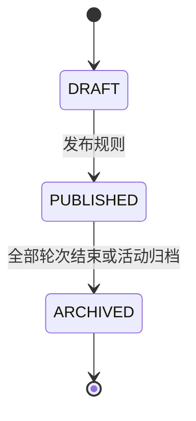
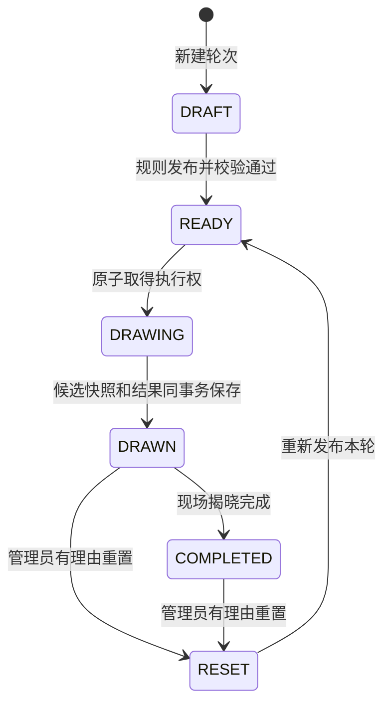
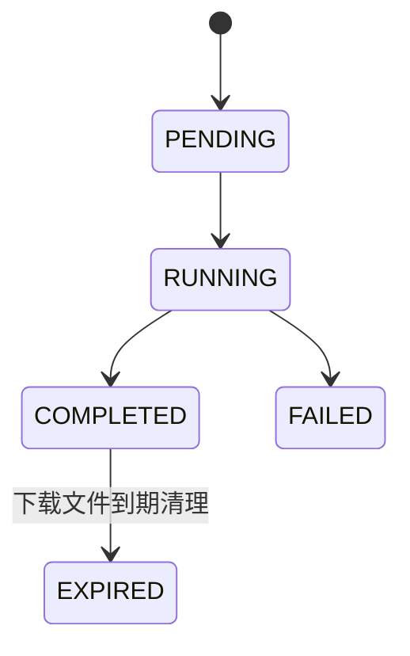

# 订购会系统状态流转设计

## 1. 通用规则

- 所有状态变化由后端校验，前端按钮显隐不能代替权限和状态控制；
- 状态变化使用数据库条件更新或乐观锁，失败返回 409；
- 自动任务和管理员手工操作使用同一领域服务，避免两套规则；
- 敏感状态变化写审计日志和 outbox 事件；
- 系统时间以数据库/后端可信时钟为准，不使用客户端时间判断开始或截止。

## 2. 活动状态机

### 2.1 状态含义

| 状态 | H5 | 基础数据 | 订单 | 抽奖/看板 |
| --- | --- | --- | --- | --- |
| `DRAFT` | 不可验证下单 | 可全量导入和编辑 | 无提交 | 仅后台预览 |
| `SCHEDULED` | 可展示活动，未开始不可提交 | 商品和白名单已锁定；需修改时先撤回发布 | 无提交 | 仅后台预览 |
| `ACTIVE` | 可验证、提交、修改、撤回 | 禁止全量导入；默认只允许有原因的单条修改 | 可写 | 看板实时；抽奖按规则执行 |
| `CLOSED` | 可验证并查看本人历史订单 | 只读 | 全部只读 | 看板实时；可继续抽奖 |
| `FINISHED` | 公开订货入口关闭 | 只读 | 全部只读 | 抽奖只读；看板和战报读取最终快照 |
| `ARCHIVED` | 公开入口关闭 | 只读 | 只读 | 只读历史结果 |

### 2.2 迁移条件

#### DRAFT → SCHEDULED

- 开始时间早于截止时间；
- 至少完成一次有效商品导入和白名单导入；
- 不存在未处理的阻断导入错误；
- 活动编号唯一；
- 不得与其他已发布、未截止活动的订货时间重叠；
- 记录管理员和发布时间。

#### SCHEDULED → ACTIVE

- 当前时间达到开始时间；不提供人工提前开始，需提前时调整为未来的新开始时间；
- 商品和白名单至少各有一条有效数据；
- 商品和白名单从发布时起已锁定 Excel 全量导入和批量删除；现场到场名单仍按现场流程维护；
- 发布 `activity.status.changed`。

#### ACTIVE → CLOSED

- 到达截止时间时调度任务自动执行；也允许管理员提前截止并填写原因；
- 截止后所有 H5 写命令返回 `ACTIVITY_CLOSED`；
- 不批量修改订单状态；
- 最终看板继续读取已提交订单。

#### CLOSED → FINISHED

- 到达整场活动结束时间时自动执行，也允许管理员填写原因后提前结束；
- 停止抽奖、重抽、规则修改和看板 SSE 实时推送；
- 撤销 H5 会话并生成最终看板与战报快照；
- 历史回看读取快照，不再动态重算。

#### FINISHED → ARCHIVED

- 不存在执行中的导入、导出或抽奖事务；
- 活动历史入口转为只读或关闭；
- `ARCHIVED` 不允许恢复，若要复用应复制为新活动。

## 3. 订单状态机

订单未提交时数据库没有正式订单记录，不创建“草稿订单”、订单号或订单版本。系统可以在独立的 `h5_order_draft` 表保存未提交购物车；该记录只是恢复界面输入的临时快照，不进入订单统计、排行、抽奖、导出或订单操作轨迹。

购物车草稿生命周期：

草稿唯一键为活动 ID + 活动客户 ID；刷新、关闭页面、重新验证同一客户或更换设备不会改变归属。其他客户即使使用同一浏览器也不能读取该草稿。草稿记录当前 `base_order_version`，与正式订单当前版本不一致时拒绝保存或恢复，避免旧页面覆盖新订单。

活动进入 `CLOSED` 或 `ARCHIVED` 后，上述所有写迁移停止，订单保持原业务状态并进入只读权限。

### 3.1 首次提交

前置条件：

- 活动为 `ACTIVE` 且当前时间早于截止时间；
- H5 令牌对应有效活动客户；
- `expectedVersion=0`；
- 至少一个有效商品、数量均为正整数；
- 商品客户类型和分公司范围匹配；
- 幂等键未被其他载荷使用。

数据变化：

- 创建唯一订单号；
- 创建 `customer_order`，状态 `SUBMITTED`，当前版本 1；
- 写当前明细、V1 和 V1 明细快照；
- 写 `FIRST_SUBMIT` 操作和看板失效事件。
- 删除该活动客户的未提交购物车草稿。

### 3.2 修改提交

- 请求 `expectedVersion` 必须等于当前版本；
- 后端重新计算完整订单，不接受差量金额；
- 当前版本号加 1，写不可变版本快照；
- 替换当前明细；
- 订单号、首次提交时间不变；
- 写 `MODIFY_SUBMIT`。
- 删除该活动客户的未提交购物车草稿。

如果两个页面同时提交，只有第一个版本更新成功；另一个返回 `ORDER_VERSION_CONFLICT`，用户刷新后决定是否重新提交。

### 3.3 撤回

- 只允许当前 `SUBMITTED` 订单；
- 仅允许订单所属客户通过 H5 撤回；管理后台没有撤回权限；
- 状态改为 `WITHDRAWN`，写撤回时间和原因；
- 当前明细、总金额、可空的总吨数、订单号和最近非空版本全部保留；
- 不生成空版本；
- 写 `WITHDRAW` 并立即从看板和抽奖有效订单候选中排除。
- 删除该活动客户的未提交购物车草稿。

### 3.4 重新提交

- 只允许活动仍为 `ACTIVE`；
- 使用原订单号；
- 以最近版本号 + 1 创建新版本；
- 状态恢复 `SUBMITTED`，清理当前撤回展示字段但操作历史保留；
- 写 `RESUBMIT`。

## 4. 导入任务状态机

### 4.1 状态规则

| 状态 | 允许操作 |
| --- | --- |
| `UPLOADED` | 查询、等待解析、取消 |
| `PARSING` | 只读查询进度 |
| `PREVIEW_READY` | 查询当前批次预览/错误、编辑或删除预览行、确认、取消 |
| `CONFIRMING` | 只读，防止重复确认；等待任务执行器领取 |
| `MATERIALIZING` | 只读；在非当前数据集内准备不可变发布版本 |
| `READY_TO_PUBLISH` | 只读；等待短事务原子发布 |
| `PUBLISHING` | 只读，防止重复发布 |
| `COMPLETED` | 查看结果和原始文件；不得修改该批次 |
| `FAILED` | 查看错误；重新上传创建新任务 |
| `CANCELLED` | 查看；重新上传创建新任务 |

以上是当前 API 和数据库实际使用的状态。当前由同一 Spring Boot 进程内的任务执行器使用任务状态和租约领取确认任务；生产环境可把同一处理器拆为独立 Worker，无需改变状态契约。

同一活动、同一数据类型只保留一个有效的未确认预览。重新上传会把此前处于 `UPLOADED`、`PARSING` 或 `PREVIEW_READY` 的旧任务标记为 `CANCELLED`；前端移除预览必须调用取消接口，不能只清除浏览器状态。任务和 staging 记录保留用于审计，不做物理删除。

发布活动时以 `activity_data_binding` 指向的正式版本为基准，只检查该版本来源任务之后的新任务。正式版本之前残留的旧预览、失败任务和已取消任务不得阻断发布；正式版本之后的新预览必须确认或取消。

### 4.2 阻断规则

- 同一活动、同一客户类型内手机号重复；
- 必填 Sheet 缺失；
- 必填字段无法识别；
- 同一业务键出现无法自动判定的多条记录；
- 订单数量等不可降级处理的字段格式非法；商品元/箱或转换系数为空/非法时按空值和数据质量提示处理，不阻断整批导入；
- 活动已开始后尝试全量导入；
- 确认时基础数据已被另一个导入批次改变。

阻断错误必须修复或删除预览行，不能只点击忽略。警告可以由管理员确认后继续。

### 4.3 商品图片预览关系

商品表仍只展示“已匹配 / 待确认 / 未匹配”，内部图片关系按标准化物料代码分组维护：

- 编辑或删除图片时同步同物料代码商品行，但不得重算、搬移或恢复其他代码的图片关系；
- `CANDIDATE` 映射为前端“待确认”，只有 `CONFIRMED` 映射为“已匹配”；没有可见关系时为“未匹配”；
- `PUBLISHED_PENDING` 存在数据库候选表中但不进入 `product_image`，所以不阻断商品版本发布，H5 在确认前使用占位图；
- 被排除或删除的关系不会成为正式图片，Worker 和后续刷新都不得再次自动恢复；
- 最终确认请求仍按每个 ZIP 路径汇总为 `CONFIRMED/PENDING/UNMATCHED`；后端按物料代码共享给重复商品行，并拒绝一个代码确认多图或一张最终图片绑定多个代码。

## 5. 现场到场关联状态

到场上传进入 `PREVIEW_READY` 后，先按当前已发布白名单实时试算；到场关联状态属于该次试算及最终发布版本的计算结果，不跨全量导入版本继承：

- 发布新的到场 Excel 时，系统针对新版本全部重新计算；上一到场版本不再参与当前业务；
- 预览行编辑或删除、白名单发布版本切换后，前端重新请求后端试算，页面直接展示 `MATCHED/PENDING_CONFIRMATION/UNMATCHED` 及统计；
- 管理员确认时提交试算所依据的白名单版本 ID；版本不一致则保持任务为 `PREVIEW_READY` 并要求刷新，不进入 `CONFIRMING`；Worker 发布前再次校验，避免并发切换白名单；
- 发布新的白名单 Excel 时，系统针对当前到场版本全部重新计算，不保留旧白名单关联；
- `MATCHED` 只有在目标客户仍属于当前有效白名单时才具备抽奖资格；
- 到场手机号只作为现场联系信息加密保存，不参与客户身份关联，也不影响关联状态；
- `PENDING_CONFIRMATION` 和 `UNMATCHED` 仅用于当前名单核对，不进入抽奖候选池；
- 当前业务页面不展示旧版本“失效”或“停用”状态，旧数据仅在导入版本和审计记录中保留。

### 4.3 失败恢复

- 解析失败不改变当前有效商品/白名单；
- staging 到发布版本的准备失败不改变当前有效商品/白名单；最终发布只切换当前版本指针，失败时当前版本保持不变；
- 对象存储中的原文件保留用于定位；
- 失败重试创建新执行尝试或新任务，不能直接把 `FAILED` 改成 `COMPLETED`；
- `PUBLISHING` 超时或连接中断后，必须先读取 MySQL 的任务状态和当前版本指针，再决定恢复为 `COMPLETED`、重新发布或标记失败，不能盲目重复切换；
- 服务重启时扫描长时间停留在 `PARSING/CONFIRMING/MATERIALIZING/READY_TO_PUBLISH/PUBLISHING` 的任务，根据租约和事务事实恢复、重新领取或标记失败。

## 5. 抽奖规则和轮次状态机

抽奖规则组状态：

抽奖轮次状态：

### 5.1 DRAFT → READY

- 中奖人数大于 0；
- 候选范围三选一；
- 最低金额只允许用于 `VALID_ORDERS`；
- 第一轮不应用排除已中奖规则，第二轮起可配置；
- 奖品名称必须填写完整且不能使用占位文字；
- 当前规则没有与已完成轮次相冲突的修改。

### 5.2 READY → DRAWN

`POST draw` 对外看似一个命令，内部短事务完成：

1. 取得 `activityId + roundId` Redis 锁；
2. 条件更新 `READY → DRAWING`；
3. 按规则查询并按活动客户 ID 去重；
4. 第一轮不排除已中奖客户；第二轮起按该轮规则决定是否按活动客户 ID 排除本活动有效中奖客户；
5. 创建递增 `attempt_no` 的抽取尝试并固定候选快照；
6. 使用安全随机算法选择指定人数；
7. 保存中奖结果、结果哈希并更新为 `DRAWN`；
8. 提交后推送 SSE。

若候选人数少于配置中奖人数，实际中奖人数取两者较小值，所有剩余候选均中奖并在规则快照中记录空缺名额；候选人数为零时不进入抽取事务。后一轮只有在所有前序轮次均为 `COMPLETED` 时才能执行。

上述数据库变化处于同一事务。中途失败全部回滚到 `READY`；现场页面不会看到未保存结果。

### 5.3 DRAWN → COMPLETED

- 现场页面已完成动画和揭晓；
- 只改变展示完成状态，不重新生成结果；
- 重复请求由幂等键返回相同状态。

### 5.4 重置

- 必须填写原因并二次确认；
- 旧抽取尝试和中奖记录改为 `INVALIDATED`，不得删除；
- 保留旧候选快照、规则快照、结果哈希、管理员和时间；
- 轮次进入 `RESET`，重新发布后才能再次抽取；
- 再次抽取创建新的 `attempt_no`，不覆盖旧尝试；
- 某轮启用排除已中奖规则时，只读取 `VALID` 结果；`INVALIDATED` 结果不影响后续候选资格。

## 6. 导出任务状态机

以下异步导出状态机是生产增强目标；当前订单导出由后台接口直接生成文件。

导出查询条件在创建任务时保存为 JSON 快照。文件过期只删除下载对象，不删除任务、审计和生成时的筛选条件。

## 7. 自动调度与幂等

当前本地环境由 Spring Boot 应用内执行器处理导入和调度，任务状态和租约保存在 MySQL；以下约束在当前进程内同样适用，生产环境可把处理器拆为独立 Worker：

- API 只在 MySQL 中创建任务记录；Worker 通过租约领取 `PENDING` 或可重试任务，使用状态条件更新或 `SELECT ... FOR UPDATE SKIP LOCKED` 避免多个 Worker 同时执行；
- 任务记录保存 `attempt_count`、`locked_until`、`next_attempt_at`、`worker_id` 和最后错误摘要。租约过期可重新领取，超过重试上限进入 `FAILED` 并告警；
- Redis 可用于唤醒 Worker 或加速查询，但不作为任务队列事实来源。Worker 处理器必须依据 MySQL 业务状态和唯一约束实现幂等；
- 每分钟扫描应该开始/截止的活动，使用条件更新避免多实例重复迁移；
- 扫描卡住的导入和 outbox 事件；
- 清理过期会话、幂等响应和导出文件；
- 所有任务以数据库当前状态为判断依据，重复执行不会产生重复结果；
- 服务器停机跨过活动截止时间后，恢复时第一轮调度必须立即把活动改为 `CLOSED`。
