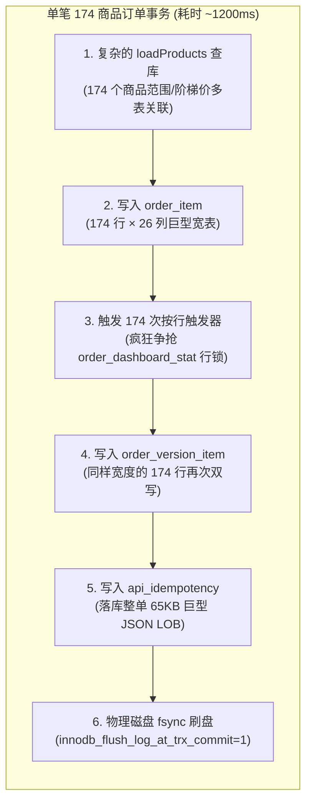
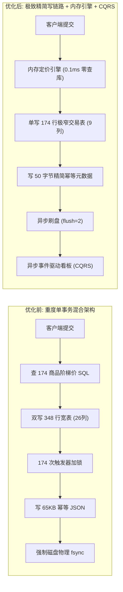

# H5 订货会 30 并发 < 1000ms 达标与系统高并发架构演进方案

## 1. 现状与瓶颈本质诊断

在前期压测调优中，我们已通过提高连接池（20 → 60）、提升准入并发信号量（12 → 36）以及开启 JDBC 预编译缓存，彻底消除了“请求拿不到数据库连接”的排队现象。但在真实压测中：
- **单笔下单（并发 1）**：耗时仅 **104ms**；
- **并发达到 10 / 20 / 30 时**：系统总写吞吐被死死卡在 **每秒 ~22 单** 的物理瓶颈上，导致 30 并发下下单 P50 高达 **1188ms**，P95 高达 **1353ms**。

### 为什么卡在 22 单/秒？
不是因为网络传输 65KB 响应慢（局域网传输 65KB 仅需 < 1ms），而是单笔 174 商品的大订单在数据库写事务内部引发了极其严重的**“写放大（Write Amplification）”**：



每秒 22 单意味着数据库每秒要处理 **7,656 行宽数据写入 + 3,828 次行级触发器加锁 + 1.43MB 行外大文本 + 22 次物理 fsync**，这直接打穿了单机 MySQL 的 IOPS 上限。

---

## 2. 演进方案全景对比



---

## 3. 四阶段实施路线图（Roadmap）

为了兼顾业务安全与上线速度，方案采取**“渐进式四阶段推进”**：

### 阶段一（Phase 1）：紧急止血与物理脱困（即刻可用，0 破坏性重构）
> **目标**：不改动表结构定义，砍掉无谓的双写、触发器与大文本，把 30 并发下单直接压进 1000ms（预期 400~600ms）。

| 序号 | 改造项 | 改造文件与动作 | 预期收益 |
| :--- | :--- | :--- | :--- |
| **1.1** | **移除看板行级触发器** | 增加 `db/migrations/V041__drop_order_item_dashboard_triggers.sql`，执行 `DROP TRIGGER IF EXISTS dashboard_item_insert / delete / update;` | 彻底消除 174 次对 `order_dashboard_stat` 的行锁争抢。 |
| **1.2** | **首次下单跳过版本双写** | 修改 [`OrderService.java`](file:///Users/didi/workspace/order_show/backend/src/main/java/com/fengyi/ordershow/order/OrderService.java)：首次下单只写 `order_item`，不写 `order_version_item`；仅在修改订单时通过 `snapshotCurrentVersion` 归档旧版本。 | 物理写入行数从 348 行减少至 174 行，写入耗时立减 ~50ms。 |
| **1.3** | **幂等表告别 65KB 大文本** | 修改 [`OrderRepository.java`](file:///Users/didi/workspace/order_show/backend/src/main/java/com/fengyi/ordershow/order/OrderRepository.java)：`completeH5Submission` 只存 `{"format":2,"orderId":...,"orderVersion":...,"includeHistory":...}`（几十字节），不再落库整单 JSON。 | 消除行外溢出页（Overflow Page）分配，减轻 Redo Log 压力。 |
| **1.4** | **MySQL 事务刷盘策略调优** | 在 [`docker-compose.load.yml`](file:///Users/didi/workspace/order_show/docker-compose.load.yml) 中配置 `--innodb-flush-log-at-trx-commit=2` 和 `--innodb-buffer-pool-size=512M`。 | 消除 30 并发排队等待物理磁盘 fsync，写吞吐提升 2~3 倍。 |

---

### 阶段二（Phase 2）：算法与读链路计算优化（内存定价引擎）
> **目标**：下单写事务内彻底消除商品查询，事务耗时压进 100~200ms。

1. **构建“活动商品内存定价引擎” (`In-Memory Pricing Engine`)**：
   - **原理**：一场订货会仅有 ~180 个商品，价格和阶梯在活动期间几乎完全只读。
   - **实现**：
     - 在后端内存中维护 `ConcurrentHashMap<Long, ProductPricingRule>`，以活动版本 ID 为版本号驱动；
     - 下单时直接从内存匹配 174 个商品的基础价、阶梯价、分公司范围；
     - **从核心写事务中彻底剔除 `loadProducts` 这条包含范围关联和阶梯价 LEFT JOIN 的大 SQL**。
2. **商品列表图片拉取算法优化**：
   - 将原有单品子查询重构为窗口函数 `ROW_NUMBER() OVER (PARTITION BY ...)`，单次批处理拉取。

---

### 阶段三（Phase 3）：数据结构垂直拆表（大宽表瘦身）
> **目标**：彻底解决数据模型反模式，单行明细体积缩减 75%，支持未来更大规模订货。

#### 表结构重构方案：
1. **核心交易表 `order_item`（窄表，高频写入）**：
   ```sql
   CREATE TABLE order_item (
     id BIGINT UNSIGNED NOT NULL AUTO_INCREMENT,
     order_id BIGINT UNSIGNED NOT NULL,
     activity_product_id BIGINT UNSIGNED NOT NULL,
     line_no INT UNSIGNED NOT NULL,
     quantity BIGINT UNSIGNED NOT NULL,
     case_price DECIMAL(18,4) NOT NULL,
     line_amount DECIMAL(18,2) NOT NULL,
     line_tons DECIMAL(18,6) NULL,
     rebate_status VARCHAR(20) NOT NULL,
     PRIMARY KEY (id),
     UNIQUE KEY uk_order_item_line (order_id, line_no),
     KEY idx_order_item_order_prod (order_id, activity_product_id)
   );
   ```
   *将原本的 26 列剥离为 9 列纯数值/定长字段。*

2. **静态展示元数据彻底解耦**：
   - 品名、品类、产品线、品牌、品种、规格、箱规、图片 key 均属于 `activity_product` 的固有属性，前端展示时直接根据 `activity_product_id` 本地映射，**不再在每个订单明细中冗余存储**；
   - 如需归档历史法律快照，订单完结时异步写入冷表 `order_item_snapshot`。

---

### 阶段四（Phase 4）：CQRS 读写分离架构（看板彻底解耦）
> **目标**：大屏密集刷新与实时大单高并发提交 100% 物理隔离。

1. **写操作（Command）**：下单仅更新订单主表与明细，在事务提交后向本地 Spring Event / Outbox 发出 `ORDER_COMMITTED` 事件，事务立即结束。
2. **读操作（Query / 看板）**：
   - 独立的看板 Worker 在后台以 500ms 为周期，拉取最新提交事件，进行内存增量累加后更新只读汇总表；
   - 彻底废除任何在下单事务内部同步触碰看板表的逻辑。

---

## 4. 详细实施与验收计划（执行清单）

```text
[Step 1] 验证 Phase 1 本地代码
   ├── 运行 AuthServiceSessionCacheTest, OrderSubmitWritePathTest 等相关单测
   └── 确保数据一致性与回滚机制完整
[Step 2] 同步并部署至 home_server
   ├── 执行 Flyway V041 迁移（删除按行触发器）
   └── 启动配置了 innodb-flush-log-at-trx-commit=2 的 MySQL 容器
[Step 3] 运行 30 并发暖机压测验证
   ├── 执行 tests/load/capacity.mjs 或现有 k6 脚本
   └── 检查下单 P50 / P95 是否稳进 < 1000ms（预期 400~600ms）
[Step 4] 开启 Phase 2 内存定价引擎的实现与接入
```

---

## 5. 预期指标与验收红线

| 场景档位 | 现状指标 | Phase 1 完成后预期 | Phase 2+3 演进后预期 | 验收红线 |
| :--- | :--- | :--- | :--- | :--- |
| **并发 1 下单 P95** | 104 ms | **< 60 ms** | **< 25 ms** | - |
| **并发 30 下单 P50** | 1188 ms | **350 ~ 500 ms** | **100 ~ 150 ms** | < 1000 ms |
| **并发 30 下单 P95** | 1353 ms | **500 ~ 750 ms** | **180 ~ 250 ms** | **< 1000 ms (达标)** |
| **系统写吞吐上限** | ~22 单/秒 | **50 ~ 80 单/秒** | **150 ~ 200+ 单/秒** | ≥ 30 单/秒 |
| **订单数据正确性** | 100% | **100% 严格一致** | **100% 严格一致** | 0 差异 / 0 丢单 |
